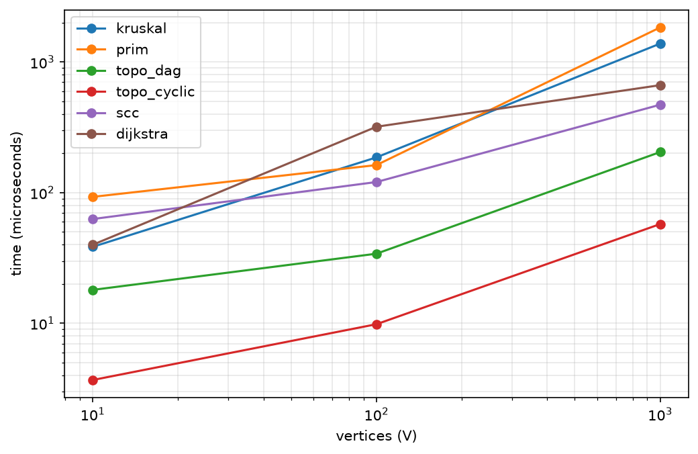
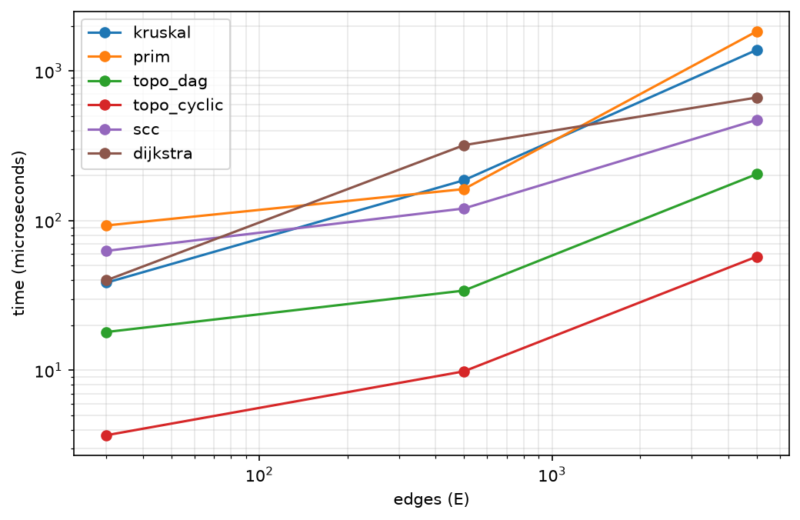

# Assignment 3: Smart City Infrastructure and Route Planning

This is a Java project that models a city as a graph and solves three tasks on it. The first is building the cheapest road network that connects all districts. The second is analysing one-way connections (topological order and strongly connected components). The third is finding shortest routes (Dijkstra). I also measured how all the algorithms behave on graphs of different sizes.

## 1. Overview

The city is a graph. Districts are vertices, roads are edges, and the weight of an edge is the construction cost or the distance, depending on the task. Vertices are numbered from 0 to V-1 and weights are integers from 1 to 100.

The project has three parts:

1. Infrastructure planning: Kruskal's and Prim's algorithms find the cheapest set of roads that connects every district.
2. Connectivity analysis: on directed graphs (one-way roads or dependencies between services) I find a valid order of dependencies, detect cycles and find groups of districts that can all reach each other.
3. Route planning: Dijkstra finds the shortest distance and the actual path from one district to all the others.

### Graph representation

The graph is stored as an adjacency list. Every vertex has a list of the edges that start in it. The graph also keeps one plain list of all edges, because Kruskal needs to sort them.

In an undirected graph each road is put into the adjacency list twice (once for each direction) and into the list of all edges once. In a directed graph each edge is stored once. An adjacency list takes O(V + E) memory and lets us walk over the neighbours of a vertex in time proportional to how many there are.

### Project structure

assignment-3
* src
* graph: Edge, Graph, GraphGenerator
* dsu: DSU
* mst: Kruskal, Prim, MSTResult
* connectivity: TopoSort, SCC, TopoResult, SCCResult
* shortestpath: Dijkstra, DijkstraResult
* benchmark: Benchmark
* tests: Tests
* Main.java
* scripts
* plot.py
* results
* tables: results.csv
* plots: time_vs_vertices.png, time_vs_edges.png
* README.md

## 2. Implementation

### Graph, Edge and GraphGenerator

Edge stores the start, the end and the weight. Graph is created with the number of vertices and a flag that says whether it is directed. It has addEdge, neighbors(u) and allEdges(). GraphGenerator creates the random graphs for the experiments, it is described in the Experimental Setup section.

### DSU

find(x) returns the root of the set that contains x. It uses path compression: after the root is found, every vertex on the way is attached directly to it. union(a, b) joins two sets and returns false if both vertices were already in the same set. It uses union by rank, so the lower tree is always hung under the higher one.

The class also keeps the number of sets, so we can check if a graph is connected (one set left at the end). It counts find and union calls too, which I use as the operation count in the experiments.

### Kruskal

I copy the list of edges and sort it by weight. Then I go through the edges from the cheapest one. If union of the two ends works, the edge joins two different components and goes into the MST. If union fails, the edge would make a cycle, so it is skipped. If one component is left at the end, the graph is connected. Otherwise the result is a spanning forest.

### Prim

I start from vertex 0 and put all its edges into a priority queue (a binary heap ordered by weight). Then I keep taking the cheapest edge. If its end is already in the tree, I skip it. If not, I add the vertex and the edge to the tree and push the edges of the new vertex into the queue. If the tree has all V vertices, the graph is connected. On a disconnected graph Prim only builds the tree of the component where vertex 0 is.

Kruskal and Prim return the same kind of result object (MSTResult) with the edges, the total weight, the connected flag and the operation counts, so they are easy to compare.

### Topological ordering

I used Kahn's algorithm. First I count the incoming edges of every vertex and put the vertices with zero incoming edges into a queue. Then I take a vertex from the queue, add it to the order and decrease the counters of its neighbours. A neighbour whose counter reaches zero goes into the queue. If the final order has fewer than V vertices, some vertices are stuck on a cycle, so no topological order exists and the graph is reported as cyclic.

### Strongly connected components

I used Kosaraju's algorithm. It has three steps. First a depth first search over the graph pushes each vertex onto a stack when it is finished. Then the graph is reversed (every edge turned around). Then I take vertices from the stack and for every unvisited one I run a DFS on the reversed graph. Everything reached in one such DFS is one component. Every vertex ends up in exactly one component.

### Dijkstra

All distances start at infinity (Long.MAX_VALUE) except the source, which is 0. A priority queue gives the vertex with the smallest known distance. For each of its edges I check if going through this vertex is shorter, and if so I update the distance and the prev array and push a new entry into the queue. Old entries stay in the queue and are skipped when they come out with a distance that is already outdated.

The path to a vertex is restored by following prev backwards. Unreachable vertices keep the distance infinity and get an empty path. If the graph has a negative weight, the algorithm throws IllegalArgumentException.

### Why Dijkstra does not work with negative weights

Dijkstra decides that the distance to a vertex is final at the moment the vertex comes out of the queue. This is only safe if all weights are non-negative, because then going further along more edges can never make a path shorter. With a negative edge a path found later can be shorter than the distance of a vertex that is already finished, and Dijkstra never goes back to fix it.

Example: A to B costs 2, A to C costs 5 and C to B costs -4. Dijkstra finishes B with distance 2, but the path A, C, B costs only 1. For graphs with negative weights Bellman-Ford should be used.

## 3. Complexity Analysis

I assume the graph is stored as an adjacency list and the priority queues are binary heaps. V is the number of vertices, E is the number of edges, and alpha(V) is the inverse Ackermann function, which is below 5 for any realistic input.

| Algorithm | Time | Extra space |
|---|---|---|
| DSU find / union | amortised O(alpha(V)) each | O(V) |
| Kruskal | O(E log E) = O(E log V) | O(V + E) |
| Prim (binary heap) | O(E log E) = O(E log V) | O(V + E) |
| Topological ordering (Kahn) | O(V + E) | O(V) |
| SCC (Kosaraju) | O(V + E) | O(V + E) |
| Dijkstra (binary heap) | O(E log E) = O(E log V) | O(V + E) |

log E and log V are the same order because E is at most V squared, so log E is at most 2 log V.

### DSU

Without optimisations a find can walk a path of length O(V). Union by rank keeps the trees low: the height only grows when two trees of equal rank are joined, so it stays at most O(log V). Path compression attaches every visited vertex directly to the root, so the next find on those vertices takes one step. Together they give amortised O(alpha(V)) per operation, which is almost constant. The memory is two arrays of size V.

### Kruskal

Sorting the edges costs O(E log E). After that there are at most E union operations of O(alpha(V)) each. Sorting is the bigger part, so the total is O(E log E). Memory is the sorted copy of the edges plus the DSU, so O(V + E). The number of edges matters most here, the number of vertices only affects the DSU.

### Prim

Every edge is pushed into the heap at most once per direction and taken out at most once, so there are O(E) heap operations that cost O(log E) each. That gives O(E log E). The heap can hold up to O(E) entries, so the memory is O(V + E). With an indexed heap or a Fibonacci heap Prim can be faster on dense graphs, but I used the simple version with a binary heap.

### Topological ordering

Counting incoming edges takes O(E). Every vertex enters the queue at most once and every edge is looked at once, when its start vertex is processed. The total is O(V + E). The extra memory is the counters and the queue, O(V).

### SCC

There are two full DFS passes and the construction of the reversed graph, each O(V + E). The reversed graph and the stack make the memory O(V + E). In the worst case the recursion of the DFS goes as deep as V.

### Dijkstra

Each edge is relaxed at most once. Each successful relaxation pushes one entry into the heap (O(log E)) and each entry is removed once, so the total is O(E log E), which is O(E log V). Memory is the distance and prev arrays plus the heap, O(V + E). The number of edges drives the running time, the number of vertices mostly gives the size of the arrays.

## 4. Experimental Setup

### Graph sizes

| Name | Vertices (V) | Edges (E) |
|---|---|---|
| Small | 10 | 30 |
| Medium | 100 | 500 |
| Large | 1,000 | 5,000 |

### How the graphs are generated

All graphs use the fixed seed 42 (java.util.Random), so the experiments can be repeated. Weights are random integers from 1 to 100. There are no duplicate edges and no self loops.

The connected undirected graph (used for Kruskal, Prim and Dijkstra) starts with a random spanning tree: every vertex v from 1 to V-1 is joined to a random earlier vertex. A tree is always connected, so the whole graph is guaranteed to be connected. After that random extra edges are added until the graph has E edges.

The DAG (used for topological ordering without cycles) is made by shuffling the vertex numbers into a random order and allowing edges only in the forward direction of this order. An edge can never go back, so a cycle is impossible.

The directed random graph (used for SCC and for topological ordering with cycles) is just random pairs (u, v) with a direction. With 3 to 5 edges per vertex such graphs contain cycles. The experiment confirms it: topological ordering gets stuck early on all three sizes (see topo_cyclic in the results) because it cannot order all vertices.

### Measurement

Each algorithm runs on each graph size. Before measuring, every algorithm is run 50 times without timing, so the JVM can compile and optimise the code (JIT warm-up). Without this the first measurements are much too slow.

After the warm-up each experiment is repeated 5 times. Every run is timed with System.nanoTime() and I report the average. The operation counts come from counters inside the algorithms. They are the same in every repetition because the graph does not change. Dijkstra runs from vertex 0 on the connected undirected graph.

### Operation counters

| Algorithm | ops_1 | ops_2 |
|---|---|---|
| Kruskal | edges examined | DSU operations (find calls + union calls) |
| Prim | edges taken out of the heap | heap operations (insert + remove) |
| Topological order | edge visits | not used |
| SCC | edge visits (both DFS passes and building the reversed graph) | not used |
| Dijkstra | edge relaxations | heap operations |

The raw table is saved in results/tables/results.csv. The plots are made by scripts/plot.py (Python with matplotlib) from this file.

## 5. Results

### Average execution time in microseconds (5 runs)

| Algorithm | Small (10 / 30) | Medium (100 / 500) | Large (1000 / 5000) |
|---|---|---|---|
| Kruskal | 38.50 | 186.24 | 1384.00 |
| Prim | 92.86 | 162.62 | 1840.54 |
| Topological order (DAG) | 18.02 | 34.10 | 204.58 |
| Topological order (with cycles) | 3.68 | 9.84 | 57.48 |
| SCC | 62.82 | 120.62 | 471.30 |
| Dijkstra | 39.92 | 319.60 | 665.14 |

### Operation counts

| Algorithm | Counter | Small | Medium | Large |
|---|---|---|---|---|
| Kruskal | edges examined | 30 | 500 | 5,000 |
| Kruskal | DSU operations | 90 | 1,500 | 15,000 |
| Prim | edges taken from heap | 30 | 500 | 5,000 |
| Prim | heap operations | 60 | 1,000 | 10,000 |
| Topological order (DAG) | edge visits | 60 | 1,000 | 10,000 |
| Topological order (with cycles) | edge visits | 30 | 500 | 5,054 |
| SCC | edge visits | 90 | 1,500 | 15,000 |
| Dijkstra | relaxations | 60 | 1,000 | 10,000 |
| Dijkstra | heap operations | 36 | 400 | 3,974 |

### Plots

Both plots use logarithmic axes, because sizes and times differ by orders of magnitude.

Execution time vs. number of vertices:

Execution time vs. number of edges:

In all my graphs the number of edges is about 3 to 5 times the number of vertices, and both grow roughly 10 times from one size to the next. That is why the two plots look almost the same, only the numbers on the x axis are different.

## 6. Comparison and Discussion

### Kruskal vs. Prim

Both algorithms look at E edges on every size (30, 500, 5,000). Kruskal does 3 DSU operations per edge (one union call and two find calls inside it), so 3E in total. Prim does 2 heap operations per edge, so 2E. Both counts grow exactly linearly with E.

The times are close. Prim was faster on the medium graph (163 µs against 186 µs), Kruskal was faster on the small graph and on the large one (1384 µs against 1841 µs). Both have O(E log E) in theory, so I did not expect a clear winner, and differences this small are partly measurement noise. The small graph result is mostly noise, since a run takes only tens of microseconds.

Both algorithms gave the same MST weight on every graph I tested (see the Testing section). Kruskal is simple, works directly on a list of edges and gives a forest for a disconnected graph. Prim grows from one vertex and fits better when the graph is dense and stored as adjacency lists.

### DSU: path compression and union by rank

I implemented DSU with both optimisations and did not benchmark a version without them, so this part is a theoretical explanation backed by the operation counts. Kruskal made only 3E DSU operations on every size and finished in about a millisecond even on the large graph. Without union by rank a find could walk a long chain of parents (O(V)), and without path compression the same long path would be walked again and again. Compression flattens the trees so repeated finds take almost one step, and union by rank stops long chains from forming. Together they make each operation almost constant.

### Topological ordering: DAG and graphs with cycles

On the DAG all vertices are processed and there are 2E edge visits (60, 1000 and 10,000), which matches O(V + E) exactly.

On the graphs with cycles the algorithm stops early. On the small and medium graph there is no vertex without incoming edges at all, so only the counting step runs (E operations). On the large graph it processes just 54 edges before it gets stuck. That is why the cyclic case is much faster (57 µs against 205 µs on the large graph). It does not mean the algorithm is better on cyclic graphs, it only gives up early because it already knows that no order can exist.

### SCC: how the runtime changes as the graph grows

SCC makes 3E edge visits (90, 1500, 15,000), which is exactly 10 times more with each step, as expected for O(V + E). The time went from 63 µs to 121 µs to 471 µs, which is less than 10 times per step. On small graphs fixed costs dominate (creating arrays, starting the DFS), and the JIT-compiled code runs faster per operation on bigger inputs, so the measured time grows slower than the operation count. The operation counts show the real linear growth.

### Dijkstra across graph sizes

Relaxations grow linearly (2E: 60, 1000, 10,000), because each undirected edge is looked at from both ends. The number of heap operations is much smaller (36, 400, 3974), since an entry is pushed only when a shorter path is found. The time went from 40 µs to 320 µs to 665 µs. The number of edges is the main factor, and the log factor from the heap makes it a bit worse than linear.

### Theory and experiment

The operation counts match the theory exactly: they are linear in E for Kruskal's examinations, Prim, Kahn, Kosaraju and Dijkstra's relaxations. This is the most reliable evidence I have.

The times go in the same direction (everything grows with the graph size), but not exactly 10 times per step. The reasons are fixed costs on small graphs, JIT compilation, cache effects and the garbage collector. Because of that I base my conclusions mostly on the large graph and on the operation counts, and I do not read too much into small differences on the small graph.

The O(V + E) algorithms (topological order and SCC) are faster than the O(E log E) ones (Kruskal, Prim, Dijkstra) on the large graph, as the theory says. They solve different problems, so this is only an illustration.

## 7. Testing

The tests are in src/tests/Tests.java. They are simple pass/fail checks without external libraries. Running the main method prints the result of every check, and all of them pass.

| Case from the assignment | What is checked |
|---|---|
| Single vertex | MST weight 0 and connected (Kruskal and Prim), topological order with one vertex, one SCC, Dijkstra distance to itself is 0 |
| Disconnected graph | Kruskal and Prim report connected = false. Kruskal returns the weight of the forest (3 for two separate edges of weight 1 and 2) |
| Multiple valid MSTs and duplicate weights | A square with all edges of weight 5. Both algorithms return the same weight 15 |
| Graph with cycles | Topological ordering detects the cycle, SCC finds 2 components (the cycle 0, 1, 2 and the vertex 3) |
| Unreachable vertices | Dijkstra returns infinity and an empty path for the unreachable vertex and the right distance for a reachable one |
| Negative weight | Dijkstra rejects the graph with an exception |
| Small graphs | All the hand-made cases above are small graphs with known answers |

On top of that there are randomised checks on 50 generated graphs (seeds 1 to 50). Kruskal and Prim return the same MST weight on connected undirected weighted graphs. The topological order is valid for every DAG, which means that for each edge u to v, u comes before v. In the directed random graphs every vertex belongs to exactly one SCC. Dijkstra's distances match Floyd-Warshall, a separate simple all-pairs algorithm, on every graph with non-negative weights. Cyclic graphs are also correctly identified when a topological order is attempted.

## 8. Conclusion

Kruskal and Prim give the same optimal MST weight and have the same O(E log V) complexity, and in my measurements their times were close. Kruskal is easier when the graph is a list of edges, and Prim is natural for dense graphs stored as adjacency lists. DSU makes the cycle check in Kruskal almost free thanks to path compression and union by rank.

Topological ordering is the right tool for ordering dependencies, for example which infrastructure service must be built first. It runs in O(V + E) and also tells us when the dependencies contain a cycle. SCC finds groups of districts or services that can all reach each other, and also runs in O(V + E), so it fits the analysis of one-way networks.

Dijkstra is the right choice for routes when all weights are non-negative, like distances or travel costs. It needs O(E log V) with a binary heap and it must not be used when weights can be negative.

The experiments confirmed the theory through the operation counts. They also showed that real running times on small inputs are strongly affected by the JVM, so the large graph and the operation counts are the better basis for conclusions.

## 9. How to Run

You need Java (I used JDK 25) and, for the plots, Python 3 with matplotlib (pip install matplotlib).

1. Run Main (src/Main.java) for a small demo.
2. Run benchmark.Benchmark. It prints the table and writes results/tables/results.csv.
3. From the project root run python scripts/plot.py. The images appear in results/plots.
4. Run tests.Tests and check that the last line says 0 failed.

All random graphs use the fixed seed 42, so the operation counts are exactly the same on every run. The times will differ a bit between computers and runs.